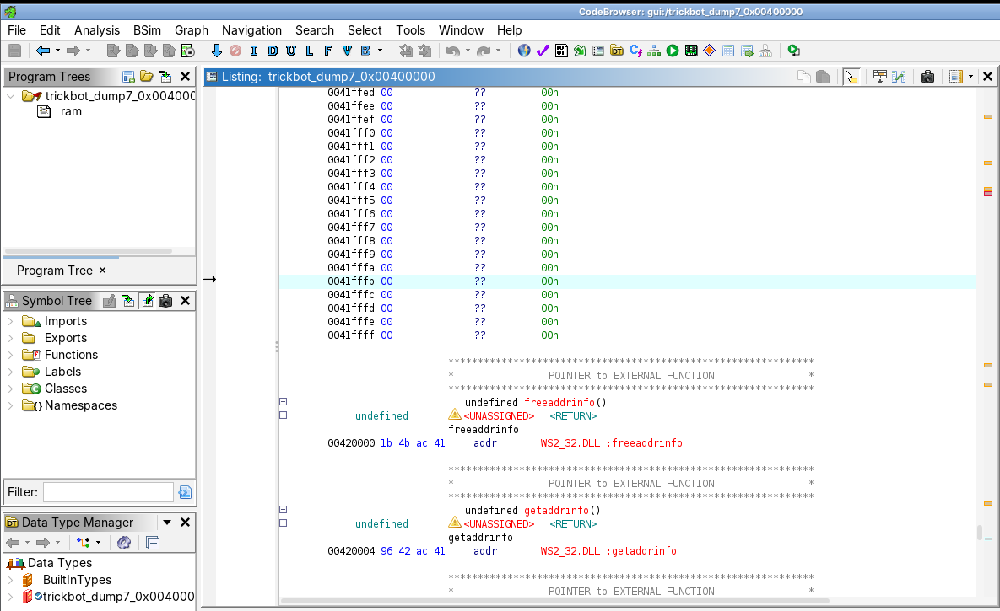

# ApiScout

ApiScout recovers the Windows API calls of malware from memory dumps.

A dumped process has no usable import table any more, but it still holds the addresses of the API functions it calls. ApiScout checks every pointer-sized value of a dump against a database of the API addresses of the system the dump was taken from. The result is the list of APIs the code uses, where it references them, and an **ApiVector**: a compact fingerprint of API usage that can be compared with those of other samples to find the malware family.

It comes as a command line tool, a Python library, a plugin for IDA Pro and a script for Ghidra.


## Quick start

```bash
pip install apiscout
```

An API DB describes one Windows installation. The repository has example DBs for Windows XP SP3 and Windows 7 SP1, the systems the dumps of [Malpedia](https://malpedia.caad.fkie.fraunhofer.de) were mostly taken on. For dumps from your own sandbox, [build a DB](#api-dbs) on it.

```bash
curl -LO https://raw.githubusercontent.com/danielplohmann/apiscout/master/dbs/win7_prof-n_sp1_example.json
apiscout scan trickbot_dump_0x00400000 --db win7_prof-n_sp1_example.json
```

```text
Scanned 147456 bytes at base address 0x400000 with 97310 APIs of 1 DBs.

Results for API DB: Microsoft Windows 7 Professional N
idx: offset    ; VA                ; IT?; #ref;DLL                                     ; API
  1: 0x00420000;         0x41ac4b1b; err;    4; ws2_32.dll_0x41ac0000 (32bit)           ; freeaddrinfo
  2: 0x00420004;         0x41ac4296; err;    3; ws2_32.dll_0x41ac0000 (32bit)           ; getaddrinfo
  3: 0x00420008;         0x41aca05b; err;    2; ws2_32.dll_0x41ac0000 (32bit)           ; gethostname
...
WinApi1024 Vector Results:
Microsoft Windows 7 Professional N: 154 / 181 (85.08%) APIs covered in WinApi1024 vector.
    Vector:     A22gQAAgABA6QACA9EAACA9gAIA9oCA4kAgRAABAAwA7CEARBADCggIAEAAJAIB.gBAEEIoAjEBIACTGgwdjTATJnJCCHpAgwNKeAJ^BFJuYAgCYQEYdn_^?
    Confidence: 89.37009000226523
```

The base address is read from a file name that ends in `0x<address>`, as memory dumps are commonly named; `--base-addr` sets it otherwise. `#ref` counts the location itself plus the `call`/`jmp` instructions that go through it.

For a PE file that was not unpacked or dumped, the import table is enough and no API DB is needed:

```bash
apiscout scan sample.exe --import-table
```

> [!IMPORTANT]
> A scan only finds APIs if the DB matches the system of the dump. On Windows versions with ASLR, DLLs are loaded at other addresses after every boot, so a DB for them has to be built on the very system the dump comes from, during the same boot. See [API DBs](#api-dbs).

## What you can do with it

### Name the malware family of a dump

An ApiVector records which of 1024 selected APIs a sample uses. Malpedia publishes the vectors of its samples; with an account, `apiscout update` downloads the current collection. A scan can then list the families with the most similar API usage:

```bash
apiscout update --db-dir dbs
apiscout scan trickbot_dump_0x00400000 --db win7_prof-n_sp1_example.json --collection dbs/2026-11-09-apivectors-v26649.csv
```

Shortened output:

```text
Top 5 individual matches
win.trickbot    - 2021-10-05-v2000035/97b489b89e6818767adde8c8f42778c04beb1512db4e4d0b6649413a2e99e6ae - 1.000
win.trickbot    - 2017-07-24/2ebeef906142f328168e7e62e8be7fbaee48e3521853d76ea778005ada6e938a          - 0.492
```

`apiscout match` compares a vector you already have, either with a collection or with a second vector. `apiscout collect` builds a collection from your own folder of dumps.

### See what a sample is about

`apiscout export <vector> --png vector.png` draws a vector as ApiQR diagram. The 1024 APIs are laid out on a curve and coloured by topic (networking, file system, crypto, GUI, ...), so samples with similar capabilities look alike. `--html` writes a page that names each API on hover.


### Annotate a dump in IDA Pro or Ghidra

Both integrations name the API pointers, type them and apply the prototypes to the calls, so that the disassembly and the decompiler read like those of a file with an intact import table. See [IDA Pro](#ida-pro) and [Ghidra](#ghidra).

### Use the results in your own tools

Every command that prints results has `--json`, and `scan` reads a dump from standard input when the file is `-`:

```bash
apiscout scan dump_0x00400000 --db win7_prof-n_sp1_example.json --json | jq -r '.apis[].api' | sort -u
```

From Python:

```python
from apiscout.ApiScout import ApiScout

scout = ApiScout("win7_prof-n_sp1_example.json")
scout.setBaseAddress(0x400000)
with open("trickbot_dump_0x00400000", "rb") as f_dump:
    results = scout.crawl(f_dump.read())
for apis in results.values():
    for offset, api_address, dll, api, bitness, in_import_table, references, callers in apis:
        print(hex(0x400000 + offset), dll, api, references)
vector = scout.getPrimaryVector(scout.getWinApi1024Vectors(results))[1]["vector"]
```

## Commands

| Command | Purpose |
| :--- | :--- |
| `apiscout scan <dump>` | List the APIs referenced in a memory dump and its ApiVector. `--import-table` reads the import table of a PE file instead. |
| `apiscout match <vector> [<vector>]` | Compare a vector with another one, or with a collection given by `--collection`. |
| `apiscout export <vector>` | Draw a vector as ApiQR diagram (`--png`, `--html`). |
| `apiscout collect <folder>` | Build a collection of ApiVectors from a folder of dumps, one sub folder per family. |
| `apiscout update` | Download the current ApiVector collection from Malpedia. |
| `apiscout dbs` | Show the API DBs that are available. |

`apiscout <command> --help` lists the options with their defaults. Results go to standard output, progress and errors to standard error; `-q` leaves only the results. The exit code is 0 on success, 1 on an error and 2 for a wrong command line.

API DBs are taken from `--db` (repeatable). Without it, all DBs of one folder are used: `--db-dir`, else `$APISCOUT_DB_DIR`, else `./dbs`.

`apiscout update` needs the `requests` package (`pip install 'apiscout[update]'`) and the API token of your Malpedia account in `~/.config/apiscout/malpedia-token`, or in a file given with `--token-file`.

<details>
<summary>The scripts of earlier versions</summary>

`scout.py`, `match.py`, `export.py`, `collect.py` and `update.py` in the repository still work as before and take the DBs from the `dbs` folder next to them. `GhidraScout.java` runs `scout.py`. `update.py` reads the Malpedia token from a `config.py` made from `template.config.py`.

</details>

## API DBs

| File in [`dbs`](dbs) | System | ASLR offsets |
| :--- | :--- | :---: |
| `winxp_prof_sp3_example.json` | Windows XP Professional SP3, 32bit DLLs | no |
| `win7_prof-n_sp1_example.json` | Windows 7 Professional N SP1, 32bit and 64bit DLLs | no |
| `win10_prof_1803_example.json` | Windows 10 Pro 1803, 32bit and 64bit DLLs | yes |
| `win2022_server_21h2_example.json` | Windows Server 2022 21H2, 32bit and 64bit DLLs | yes |

The Windows XP and Windows 7 DBs were built on systems without ASLR and fit dumps from such systems. The Windows 10 and Windows Server 2022 DBs carry the load addresses of the boot they were built in. They show the format and serve the tests, but do not fit dumps from other machines.

To build a DB for your own analysis system, run the DB builder on it:

```bash
cd apiscout/db_builder
python DatabaseBuilder.py --auto
```

`--auto` takes the commonly used DLLs of the system folders and their ASLR offsets, `--paths` and `--filter` choose folders and DLLs. It also runs on other operating systems for a copy of the DLLs (`--os_name`, `--os_version`); the load addresses then come from the module list of a process on the target system (`--load_addresses`, lines of `<hex load address> <DLL path>`).

## IDA Pro

`ida_scout.py` works as plugin and as script (File > Script file...) with IDA 9.0 and newer. To use it as plugin, install it with the plugin manager (`hcli plugin install <path to apiscout>`) or link the repository into `$IDAUSR/plugins`; it is then available as Edit > Plugins > ApiScout (<kbd>Ctrl</kbd>+<kbd>Alt</kbd>+<kbd>A</kbd>).

After choosing the API DBs, the API references found are listed in the dockable ApiScout view shown at the top of this page.

| Key | Action |
| :--- | :--- |
| <kbd>Enter</kbd> or double click | Jump to the reference |
| <kbd>A</kbd> | Annotate the selected APIs |
| <kbd>Shift</kbd>+<kbd>A</kbd> | Annotate all APIs of the view (IDA's quick filter only hides rows) |
| <kbd>F</kbd> | Only show APIs with a neighbour within a given distance |
| <kbd>Ctrl</kbd>+<kbd>U</kbd> | Scan the database again |

Annotating an API names its location, types it as pointer to the API's prototype and applies the prototype to the calls referencing it. Memory dumps should be loaded as binary file at the address they were dumped from.

In batch mode, all references are annotated:

```bash
idat -A -TBinary -b<dump address / 16, hex> -pmetapc -S"ida_scout.py <API DB> [<API DB> ...]" <dump>
```

The segment base that `-b` sets is reset to 0 so that calls reference the API pointers, and the database is saved when the script is done. A database that was analysed with such a base before is repaired as far as possible; functions that IDA split under the base stay split, switches it missed there are not recovered, and `noreturn` flags are determined again, so the batch command is best run on the dump itself. Without `-TBinary`, IDA loads a dump that starts with a PE header as file instead of as memory image, and idat creates a 64bit database for binary files, so 32bit dumps are best prepared as database first.

## Ghidra

Copy `GhidraScout.java` into a script directory of Ghidra and run it from the Script Manager (ticking its "In Tool" checkbox adds it as Tools > ApiScout). It asks for the location of `scout.py` once and runs it on the memory of the current program, so `python3` needs to be able to run `scout.py`. Tested with Ghidra 12.2.

The table lists the API references found, the selected ones are annotated like imports: a pointer with an external reference to the function of its library, with the prototype of Ghidra's Windows data type archive.



Headless:

```bash
analyzeHeadless <project> <name> -import <dump> -loader BinaryLoader -loader-baseAddr <address> -processor x86:LE:64:default -postScript GhidraScout.java <path to scout.py> [<API DB> ...]
```

## Background

* [ApiScout: Painless Windows API information recovery](http://byte-atlas.blogspot.com/2017/04/apiscout.html) describes the method.
* [ApiVectors](https://byte-atlas.blogspot.com/2018/04/apivectors.html) explains how the fingerprints are built and stored.
* [ApiScout: Robust Windows API Usage Recovery for Malware Characterization and Similarity Analysis](https://cyberjournal.cecyf.fr/index.php/cybin/en/article/download/20/15/50) (Botconf 2018) evaluates it over Malpedia.

## Development

ApiScout requires Python 3.10 or newer. [uv](https://docs.astral.sh/uv/) sets up the environment:

```bash
uv sync
uv run python -m unittest discover -s tests -p "test*.py" -t .
uv run ruff check && uv run ruff format --check && uv run ty check
```

Questions and bug reports are welcome as [issues](https://github.com/danielplohmann/apiscout/issues). ApiScout is written by Daniel Plohmann and [contributors](https://github.com/danielplohmann/apiscout/graphs/contributors) and licensed under the [BSD 2-Clause License](LICENSE).

## Version History

<details>
<summary>All versions</summary>

 * 2026-11-17: `apiscout` command line tool (`pip install apiscout`): `scan`, `match`, `export`, `collect`, `update` and `dbs` replace the scripts of the same purpose for everyday use, with `--json` output, `--db`/`--db-dir`/`$APISCOUT_DB_DIR` to choose API DBs, and errors that say what to do. The scripts stay as they are, `GhidraScout.java` keeps using `scout.py`. `update` reads the Malpedia token from a file instead of `config.py`.
 * 2026-11-16: Added a Windows Server 2022 (21H2, build 20348) 64bit import DB (`dbs/win2022_server_21h2_example.json`, 343 DLLs, built with `DatabaseBuilder.py --filter` on a fresh installation). Like the Windows 10 DB, it carries the ASLR offsets of the boot it was built in and serves as example and for tests, not for dumps of other systems.
 * 2026-11-16: v3.0.0 - (BREAKING) Python 2 and IDA before 9.0 are no longer supported. Packaging moved to `pyproject.toml` (with `uv.lock`), code is linted and formatted with ruff and type checked with ty, CI runs on GitHub Actions.
   * Library: fixed a crash when a buffer ends in `FF 15`/`FF 25`, import tables (`scout.py -t`) are read by the own parser only, which gave the same imports as LIEF on all files tested and is bounded for crafted files, so LIEF is no longer a dependency, import descriptors without import name table, PE mapping of truncated or unusual files, matching of vectors given as lists, `NaN` when matching empty vectors, and API DBs of the same OS replacing each other. Crawl results are now ordered by offset. Imports by ordinal are resolved for `ws2_32.dll`, `wsock32.dll` and `oleaut32.dll`, compressed ApiVectors are validated, and a 32bit and a 64bit export at the same address are both resolved.
   * `export.py` (ApiQR) works again, `update.py` works from any directory, `collect.py -u` no longer writes a second file.
   * IDA: `ida_scout.py` is a plugin now (see above) with a dockable results view instead of a modal dialog, a batch mode and `ida-plugin.json` for the plugin manager. APIs are also annotated when their location was defined as something else before, type libraries match the bitness of the database and include ntapi, API locations are typed as function pointers, and the decompiler shows the API names for dumps loaded as binary file.
   * Ghidra: the script scans the program's memory instead of the imported file, keeps all references to an API, annotates them like imports (external references and prototypes) and can be run headless.
   * DB Builder: `--os_name`/`--os_version` build a DB from a copy of the DLLs on any OS, `--load_addresses` takes the ASLR offsets from a module list (lines of `<hex load address> <DLL path>`) instead of loading each DLL; DLLs are matched by folder and file name, or by file name alone where it is unique. The DLL filter covers DLLs of current Windows versions.
 * 2026-11-16: Follow-ups for the Windows 10 DB: `collect.py` now skips API DBs with ASLR offsets unless `--use_aslr_dbs` or `--ignore_aslr` is given (`FingerprintCrawler` got an `ignore_aslr_offsets` parameter) and loading a DB warns about many colliding addresses. ApiVector now matches DLL names case-insensitively (e.g. `IPHLPAPI.DLL`). Fixed `ws2_32.dll` being truncated in the JSON output of `scout.py`, missed references of 64bit `jmp [rip+x]` thunks, the base address of PE32+ headers and 64bit imports by ordinal. Tests now run with `unittest` instead of nose.
 * 2026-11-01: Added Windows 10 Pro 1803 (build 17134.1) 64bit import DB, including the ASLR offsets of the boot it was built in (as all 64bit system DLLs share the file ImageBase 0x180000000). These offsets are only valid for memory dumps from that very boot; for other dumps, use import table parsing (`scout.py -t`) or rebuild the DB on the system the dump was taken from. `scout.py --ignore_aslr` (`ApiScout.ignoreAslrOffsets(True)`) is only meaningful for systems without ASLR and not usable for this DB's 64bit DLLs, as they then overlap at 0x180000000. Also note that the offsets of several rarely loaded DLLs in this DB (mostly 32bit ones, e.g. iphlpapi.dll, wininet.dll) put them at overlapping addresses, so APIs of these DLLs may be resolved incorrectly. Also fixed two DB Builder bugs: version 0.0.0.0 was written for all DLLs, and ordinal-only exports were truncated for DLLs mapping many ordinals to one address (e.g. mfc42.dll lost ~90% of its exports).
 * 2023-03-27: v2.0.2 - Bugfix for IdaScout and handling of sets, contributed by @7a6570 (THX!!)
 * 2023-01-02: v2.0.1 - Bugfix for lief-based import table parsing with Python 3.10, contributed by @malware-kitten (THX!!)
 * 2022-08-01: v1.2.0 - Added plugin for Ghidra, contributed by @mari-mari (THX!!)
 * 2022-09-20: v2.0.0 - (potentially BREAKING) crawl results now have one additional output field with a set of calling references for a given WinAPI. This is also included in the JSON output of `scout.py`, contributed by @renzhexigua (THX!!)
 * 2022-08-01: v1.2.0 - Added plugin for Ghidra, contributed by @mari-mari (THX!!)
 * 2022-01-17: v1.1.9 - Fixed `ida_scout.py` to work with IDA 7.5+ when apiscout is also installed as a Python package.
 * 2021-10-04: v1.1.8 - Extension of winapi contexts based on observations provided by @blattm (THX!).
 * 2021-08-30: v1.1.7 - Fixed deprecation warning in ApiQR as raised by numpy.
 * 2021-07-31: v1.1.6 - It's no longer required to keep a fixed LIEF version. (THX to @cccs-rs!)
 * 2021-01-10: v1.1.5 - Python3 LIEF package fixed to version 0.10.1 (THX to @akhribfarouk!)
 * 2020-12-09: v1.1.4 - Python3 fixes on DatabaseBuilder (THX to @Dump-GUY!)
 * 2020-07-13: v1.1.3 - Added "install_requires" to setup.py to ensure dependencies are installed.
 * 2020-06-30: v1.1.0 - Now using LIEF for import table parsing. Fixed bug which would not produce ApiVectors when using import table parsing. ApiScout is now also available through PyPI.
 * 2020-03-03: Added a script to pull the most recent ApiVector DB from Malpedia (requires Malpedia account / API token).
 * 2020-03-02: Ported to IDA 7.4 (THX to @jenfrie).
 * 2020-02-18: DB Builder is now compatible up to Python 3.7 (THX to @elanfer).
 * 2019-10-08: Workaround for broken filtering of the API view in IDA 7.3 (THX to @enzok for pointing this out).
 * 2019-08-22: Fixed a bug where missing type info in IDA would lead to a crash (now gives an error message instead).
 * 2019-08-20: Added self-filter to eliminate pointers to own memory image that could be mistakenly treated as API references.
 * 2019-06-06: Added support for proper type reconstruction for annotated APIs in IDA Pro (THX to @FlxP0c)
 * 2019-05-15: Added numpy support for vector calculations (based on implementation provided by @garanews - THX!)
 * 2019-05-15: Fixed a bug in PE mapper where buffer would be shortened because of misinterpretation of section sizes.
 * 2019-01-23: QoL improvements: automated data folder deployment when used as module, logger initialization (THX to @jdval)
 * 2018-08-23: Fixed a bug in PE mapper where the PE header would be overwritten by (empty) section data.
 * 2018-08-21: Added functionality that allows to use import table information instead of crawling for references.
 * 2018-07-31: Fixed convenience functions to create/export vectors from/to lists and dicts, added test coverage.
 * 2018-07-23: WARNING: Change in Apivector format -- Introduced sorted ApiVectors which are even more space efficient (20%+).
 * 2018-06-25: Fixed incompatibility with IDA Pro 7.0+ (THX to @nazywam!)
 * 2018-05-23: Added further semantic context groups (THX to Quoscient.io)
 * 2018-03-27: Heuristic estimation of Windows API reference counts added
 * 2018-03-06: ApiQR visualization of vector results (C-1024)
 * 2017-11-28: Added own import table parser to enrich result information
 * 2017-08-24: Multi-Segment support in IDA Pro (THX to @nazywam!)
 * 2017-05-31: Added Windows 7 SP1 64bit import DB (compatible to Malpedia)

## Credits

The idea has previously gone through multiple iterations until reaching this refactored release.  
Thanks to Thorsten Jenke and Steffen Enders for their previous endeavours and evaluating a proof-of-concept of this method.  
More thanks to Steffen Enders for his work on the visualization of ApiQR diagrams.  
Also thanks to Ero Carrera for pefile and Elias Bachaalany for the IDA Python AskUsingForm template. :)  
Additionally many thanks to Andrea Garavaglia for his performance benchmarks that lead to drastic speedups in the applied matching!  


Pull requests welcome! :)

</details>
