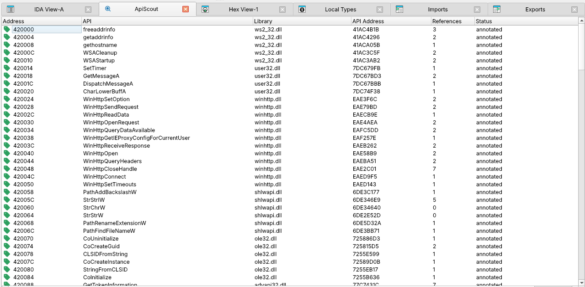

# ApiScout

ApiScout recovers the Windows API calls of malware from memory dumps.

A dumped process has no usable import table, but it still holds the addresses of the APIs it calls. ApiScout matches every pointer-sized value of a dump against a database of the API addresses of the system the dump came from. You get the APIs the code uses, where it references them, and an **ApiVector**: a fingerprint of API usage that points to the malware family.

Command line tool, Python library, and plugins for IDA Pro, Ghidra and Binary Ninja.



## Quick start

Python 3.10 or newer:

```bash
pip install apiscout
apiscout dbs download
apiscout scan trickbot_dump_0x00400000 --db win7_prof-n_sp1_example.json --min-confidence 0
```

```text
Results for API DB: Microsoft Windows 7 Professional N
idx: offset    ; VA                ; IT?; #ref;DLL                                     ; API
  1: 0x00409aef;         0x10006839; err;    1; devrtl.dll_0x10000000 (32bit)           ; NdxTableAddObjectToList
---------------------------------------------------------------------------------------------------
  2: 0x00420000;         0x41ac4b1b; err;    4; ws2_32.dll_0x41ac0000 (32bit)           ; freeaddrinfo
  3: 0x00420004;         0x41ac4296; err;    3; ws2_32.dll_0x41ac0000 (32bit)           ; getaddrinfo
  4: 0x00420008;         0x41aca05b; err;    2; ws2_32.dll_0x41ac0000 (32bit)           ; gethostname
  [...]
DLLs: 15, APIs: 183, references: 496

WinApi1024 Vector Results:
Microsoft Windows 7 Professional N: 154 / 181 (85.08%) APIs covered in WinApi1024 vector.
    Vector:     A22gQAAgABA6QACA9EAACA9gAIA9oCA4kAgRAABAAwA7CEARBADCggIAEAAJAIB.gBAEEIoAjEBIACTGgwdjTATJnJCCHpAgwNKeAJ^BFJuYAgCYQEYdn_^?
    Confidence: 89.37009000226523
```

`dbs download` fetches the example API DBs. Those for Windows XP SP3 and 7 SP1 fit most dumps of [Malpedia](https://malpedia.caad.fkie.fraunhofer.de). The base address is read from a file name ending in `0x` and 8 to 16 hex digits, otherwise give `--base-addr`. Without a dump, `apiscout scan program.exe --import-table` reads the imports of a program instead.

A Windows minidump (`MDMP` signature, e.g. `crash.dmp`) is scanned as it is, range by range at its own addresses: offsets are virtual addresses (relative to `--base-addr`, if given), and references inside the images of the system DLLs of its module list are left out.

<details>
<summary>How to read the listing</summary>

| Column | Meaning |
| :--- | :--- |
| `offset` | Where the API address is stored in the dump. |
| `VA` | The API address found there. |
| `IT?` | Whether the location lies in the import table of the dump: `yes`, `no`, or `err` if the dump has no import table that can be read, which is normal for dumped code. |
| `#ref` | The location itself plus the `call` and `jmp` instructions that go through it. |
| `DLL` | The DLL, the address it is loaded at according to the DB, and whether it is the 32bit or 64bit one. |

A single API far away from all others, like the first row, is usually a chance hit: bytes that happen to equal an API address. The example keeps it with `--min-confidence 0`; a plain `apiscout scan` drops it. `--filter 32` drops APIs that have no other API within 32 bytes.

`--min-confidence N` is the finer tool: every hit gets a confidence from 0 to 100 (`confidence` in `--json`) from its neighbours, calls through it, the import table, its alignment and agreeing API DBs, and hits below N are dropped (`apiscout scan --help` has the formula). The default is 20, which drops the chance hits of a scan with the right API DB; `--min-confidence 0` keeps every hit.

`Confidence` (0 to 100) says how much a vector is worth as a fingerprint. It is low when only few or only very common APIs were found.

</details>

> [!IMPORTANT]
> The DB has to describe the system the dump was taken on: same DLL versions. With ASLR, the load addresses change at every boot, so `scan` places the DLLs where the dump has them: by the module list of a minidump, by `--modules FILE` (lines of `<hex load address> <DLL path>`, as `DatabaseBuilder.py --load_addresses` reads them) or by DLL images it finds in the dump (`placed_dlls` in the JSON output). DLLs it does not find keep the addresses of the DB, and so do DLLs whose load address the DB has from its ASLR offsets (unless `--ignore-aslr`), as an image may be a copy the sample mapped itself. See [API DBs](#api-dbs).

## Features

**Name the family.** `--collection` compares the vector with a collection of vectors, such as the one Malpedia publishes (`apiscout update` downloads it with a Malpedia API token in `~/.config/apiscout/malpedia-token`):

```bash
apiscout scan trickbot_dump_0x00400000 --db win7_prof-n_sp1_example.json --collection 2026-11-09-apivectors-v26649.csv
```

```text
Top 5 individual matches
win.trickbot    - 2021-10-05-v2000035/97b489b8[...]  - 1.000
win.trickbot    - 2017-07-24/2ebeef90[...]           - 0.492
```

**Explain the match.** `--explain` lists the APIs that drive a score, shared or only on one side, with their weights (`apiscout match VECTOR OTHER --explain`).

**See what a sample does.** `apiscout export` draws a vector as ApiQR diagram: each of the 1024 APIs has a fixed place and a colour for its topic (network, files, crypto, memory, ...), so similar samples look alike.


```bash
VECTOR=$(apiscout scan trickbot_dump_0x00400000 --db win7_prof-n_sp1_example.json --json | jq -r .apivector)
apiscout export "$VECTOR" --png vector.png --html vector.html
```

**Find what is resolved at run time.** `--dynamic` also looks for APIs that a program never stores as pointers: hashes of their names (ROR13, Metasploit block_api, CRC32, djb2, FNV-1a, sdbm, also when a sample XORs or adds a key of its own, which is listed) in groups of at least three, as shellcode and loaders compare them, and their names as strings, in runs of at least three. They are listed after the pointers and added to the ApiVector.

**Script it.** `--json` gives machine-readable output, `-` reads standard input:

```bash
apiscout scan dump_0x00400000 --json | jq -r '.apis[].api' | sort -u
apiscout scan dump_0x00400000 --json | apiscout match - --collection apivectors.csv
```

In scan JSON, `apivector_db` names the API map that produced `apivector`. With `--import-table`, the label is `import_table`.

<details>
<summary>From Python</summary>

```python
from apiscout.ApiScout import ApiScout

scout = ApiScout("win7_prof-n_sp1_example.json")
scout.setBaseAddress(0x400000)
with open("trickbot_dump_0x00400000", "rb") as f_dump:
    results = scout.crawl(f_dump.read())
for apis in results.values():
    for offset, api_address, dll, api, bitness, in_import_table, references, callers in apis:
        print(hex(0x400000 + offset), dll, api, references)
vector = scout.getPrimaryVector(scout.getWinApi1024Vectors(results))[1]["vector"]
```

</details>

## Commands

| Command | Purpose |
| :--- | :--- |
| `apiscout scan <dump>` | List the APIs referenced in a memory dump, with its ApiVector |
| `apiscout match <vector>` | Compare a vector with another one or with a collection |
| `apiscout export <vector>` | Draw a vector as ApiQR diagram |
| `apiscout collect <folder>` | Build a collection from a folder of dumps |
| `apiscout update` | Download the current collection from Malpedia (`pip install 'apiscout[update]'`) |
| `apiscout dbs` | Show the available API DBs |
| `apiscout dbs download` | Download the example API DBs |

`apiscout <command> --help` shows options and examples. Without `--db`, the DBs of `--db-dir`, `$APISCOUT_DB_DIR`, `./dbs` or the download folder are used. Exit codes: 0 success, 1 error, 2 wrong usage.

## API DBs

| File in [`dbs`](https://github.com/danielplohmann/apiscout/tree/master/dbs) | System | ASLR offsets |
| :--- | :--- | :---: |
| `winxp_prof_sp3_example.json` | Windows XP Professional SP3, 32bit | no |
| `win7_prof-n_sp1_example.json` | Windows 7 Professional N SP1, 32 and 64bit | no |
| `win10_prof_1803_example.json` | Windows 10 Pro 1803, 32 and 64bit | yes |
| `win2022_server_21h2_example.json` | Windows Server 2022 21H2, 32 and 64bit | yes |
| `win11_pro_26h2_example.json` | Windows 11 Pro 26H2, 32 and 64bit | yes |

`apiscout dbs download` checks them against [`dbs/SHA256SUMS`](https://github.com/danielplohmann/apiscout/blob/master/dbs/SHA256SUMS) and stores them in `~/.local/share/apiscout/dbs`, `~/Library/Application Support/apiscout/dbs` or `%LOCALAPPDATA%\apiscout\dbs`. DBs with ASLR offsets fit dumps of the boot they were built in, and those of other boots when the load addresses are given as described above.

For your own analysis system, run the DB builder on it (Python 3.10 or newer, which Windows 7 has no build of: build the DB of such a system from a copy of its DLLs on another system, with `--os_name`, `--os_version` and `--load_addresses` as described below):

```bash
git clone https://github.com/danielplohmann/apiscout
cd apiscout
python -m apiscout.db_builder --auto
```

The builder needs only the standard library, so on a machine without a clone, a copy of the `apiscout` folder of it is enough: run the command in the folder that holds it.

`--paths` and `--filter` choose folders and DLLs, `--os_name` and `--os_version` build a DB from a copy of the DLLs on another system, and `--load_addresses` then takes the load addresses from a module list.

Without a machine of the build, `python -m apiscout.db_builder.DllDownloader --windows 11-24H2 --update KB5046617 --out win11` downloads the DLLs of the filter from Microsoft's symbol server, finds them with [Winbindex](https://github.com/m417z/winbindex), checks each against its SHA-256 and builds the DB (standard library only, no ASLR offsets, so scan with `--modules` or a minidump). `--update` also takes a build such as `26100.2605`, `--list` shows the Windows versions and updates, `--windows 11-24H2 --list` the updates of one.

Some DLLs export most of their functions by ordinal only, MFC's `mfc42.dll` and `mfc42u.dll` thousands of them, which a DB lists as `None<ordinal>`. Both tools take the module-definition (`.def`) file such a DLL was linked with, which names them: `--def32 MFC42.DEF` for the 32bit DLL, `--def64` for the 64bit one (its names and ordinals differ). Visual C++ ships them with the MFC sources; take the one of the same MFC version, because a name is only looked up by its ordinal. The DLL is the one the `LIBRARY` line names, or the one named like the file, and exports that have a name keep it. A DEF file whose C++ names are decorated for the other bitness is refused, and one that names an export otherwise than the DLL does is not used for that DLL.

## IDA Pro

`plugins/ida/ida_scout.py` works as plugin (`hcli plugin install <clone>/plugins/ida`, which installs apiscout from PyPI, and `apiscout dbs download` for the DBs, then Edit > Plugins > ApiScout, <kbd>Ctrl</kbd>+<kbd>Alt</kbd>+<kbd>A</kbd>) or as script, with IDA 9.0 and newer. Load the dump as binary file with its address as loading offset and 0 as loading segment, choose the API DBs, and work in the ApiScout view:

| Key | Action |
| :--- | :--- |
| <kbd>Enter</kbd> | Jump to the reference |
| <kbd>A</kbd> / <kbd>Shift</kbd>+<kbd>A</kbd> | Annotate the selected / all APIs |
| <kbd>F</kbd> | Only APIs with a neighbour within a distance |
| <kbd>Ctrl</kbd>+<kbd>U</kbd> | Scan again |

Annotated APIs are named, typed as pointers to their prototype, and the calls through them get the prototype too.

The DLLs of the API DBs are placed at the load addresses of the module list file you give in the form (optional, lines of `<hex load address> <DLL path>` as for `apiscout scan --modules`), so one DB fits the dumps of every boot.

<details>
<summary>Batch mode</summary>

```bash
idat -A -TBinary -b<dump address / 16, hex> -pmetapc -S"<clone>/plugins/ida/ida_scout.py <API DB> [<API DB> ...] [--modules <module list>]" <dump>
```

Annotates everything and saves the database. The segment base from `-b` is reset to 0. DBs in the `dbs` folder of the clone or the download folder can be given by name. idat creates 64bit databases for binary files, so prepare 32bit dumps as database first.

</details>

## Ghidra

`plugins/ghidra/ghidra_scout.py` runs in PyGhidra (Ghidra 12, tested with 12.2):

1. Start Ghidra with `support/pyghidraRun`. The first start creates its virtual environment.
2. Install ApiScout there, e.g. `~/.config/ghidra/ghidra_12.2_PUBLIC/venv/bin/python3 -m pip install apiscout` (Windows: `%APPDATA%\ghidra\ghidra_<version>_PUBLIC\venv\Scripts\python.exe`, macOS: `~/Library/ghidra/ghidra_<version>_PUBLIC/venv/bin/python3`).
3. Copy the script into `~/ghidra_scripts`, or add `plugins/ghidra` of a clone of the repository as script directory (then step 2 is not needed).
4. Run it from the Script Manager, category ApiScoutForGhidra.

It asks once for the DB folder, scans the program's memory and annotates the references you select like imports, with prototypes from Ghidra's Windows data types.

The DLLs of the API DBs are placed at the load addresses of a module list file, as `apiscout scan --modules` does (choose `Module list file...` in the dialog).


<details>
<summary>Headless</summary>

```bash
pyghidraRun -H <project folder> <project name> -import <dump> -loader BinaryLoader -loader-baseAddr <address> \
    -processor x86:LE:64:default -scriptPath <clone>/plugins/ghidra \
    -postScript ghidra_scout.py <API DB> [<API DB> ...] [--modules <module list>]
```

Use `-processor x86:LE:32:default` for 32bit dumps.

</details>

## Binary Ninja

The plugin in `plugins/binja_scout` works with Binary Ninja 6 (tested with 6.0):

1. Install ApiScout for Binary Ninja's Python: `Install python3 module` in the command palette.
2. Link `plugins/binja_scout` into the `plugins` folder of the [user folder](https://docs.binary.ninja/guide/index.html#user-folder).

The extension manager needs neither step: it installs the repository with numpy.

Open the dump with Open with Options as `Mapped` view, with its address as image base and `windows-x86` or `windows-x86_64` as platform, then use Plugins > ApiScout to scan, show the results and annotate all or filtered references. Calls through annotated pointers read as API calls in HLIL.

The DLLs of the API DBs are placed at the load addresses of the module list file you give in the form (optional, `modules=` of `scan_and_annotate`), as `apiscout scan --modules` does.

<details>
<summary>Headless</summary>

```python
import binaryninja
from apiscout.BinaryNinjaTools import scan_and_annotate

with binaryninja.load("dump.bin", options={"loader.platform": "windows-x86", "loader.imageBase": 0x400000}) as bv:
    result = scan_and_annotate(bv, ["dbs/win7_prof-n_sp1_example.json"])
    print(result["annotated"], "of", len(result["rows"]), "API references annotated")
```

A dump with PE header has to be opened as `Mapped` view through the load settings:

```python
raw = binaryninja.BinaryView.open("trickbot_dump7_0x00400000")
settings = binaryninja.BinaryViewType["Mapped"].get_load_settings_for_data(raw)
settings.set_integer("loader.imageBase", 0x400000, raw)
settings.set_string("loader.platform", "windows-x86", raw)
raw.set_load_settings("Mapped", settings)
bv = binaryninja.load(raw, options={"loader.imageBase": 0x400000, "loader.platform": "windows-x86"})
```

</details>

## Background

- [ApiScout: Painless Windows API information recovery](http://byte-atlas.blogspot.com/2017/04/apiscout.html)
- [ApiVectors](https://byte-atlas.blogspot.com/2018/04/apivectors.html)
- [ApiScout: Robust Windows API Usage Recovery for Malware Characterization and Similarity Analysis](https://cyberjournal.cecyf.fr/index.php/cybin/en/article/download/20/15/50) (Botconf 2018)

## Development

```bash
uv sync
uv run python -m unittest discover -s tests -p "test*.py" -t .
uv run ruff check && uv run ruff format --check && uv run ty check
```

Tests on Malpedia dumps run when `APISCOUT_SAMPLES` names their folder, the Binary Ninja tests when `binaryninja` can be imported. Changes are listed in the [changelog](https://github.com/danielplohmann/apiscout/blob/master/CHANGELOG.md).

Releases are cut by pushing a version tag, see [RELEASING.md](https://github.com/danielplohmann/apiscout/blob/master/RELEASING.md).

Questions, bug reports and pull requests are welcome on [GitHub](https://github.com/danielplohmann/apiscout/issues). ApiScout is licensed under the [BSD 2-Clause License](https://github.com/danielplohmann/apiscout/blob/master/LICENSE).

## Credits

ApiScout is written by Daniel Plohmann and [contributors](https://github.com/danielplohmann/apiscout/graphs/contributors). The idea has gone through multiple iterations until reaching this release.

- Thorsten Jenke and Steffen Enders for their previous endeavours and for evaluating a proof of concept of this method.
- Steffen Enders for his work on the visualization of ApiQR diagrams.
- Ero Carrera for pefile and Elias Bachaalany for the IDA Python AskUsingForm template.
- Andrea Garavaglia for the performance benchmarks that led to drastic speedups of the matching.
