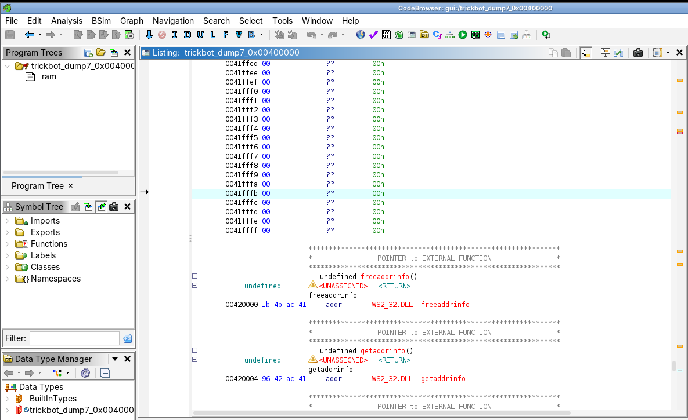

# Disassembler integrations

Use an [API database](databases.md) that matches the DLL versions in your dump. If you have a module list, you can use it to set the DLL load addresses in any of the three integrations. Each integration checks the standard database locations, including `APISCOUT_DB_DIR` when set. Results show per-hit confidence. A minimum confidence of 0 keeps all hits.

## IDA Pro

ApiScout works with IDA 9.0 and newer as a plugin or as a script.

1. For plugin mode, run `hcli plugin install <clone>/plugins/ida`. This installs ApiScout from PyPI.
2. Run `apiscout dbs download` for the example databases.
3. Load the dump as a binary file with its address as the loading offset and 0 as the loading segment.
4. Open **Edit → Plugins → ApiScout**, press <kbd>Ctrl</kbd>+<kbd>Alt</kbd>+<kbd>A</kbd>, or run `plugins/ida/ida_scout.py` as a script. Choose the API databases in the dialog.

| Key | Action |
| :--- | :--- |
| <kbd>Enter</kbd> | Jump to the reference |
| <kbd>A</kbd> / <kbd>Shift</kbd>+<kbd>A</kbd> | Annotate the selected / all APIs |
| <kbd>F</kbd> | Only APIs with a neighbour within a distance |
| <kbd>Ctrl</kbd>+<kbd>U</kbd> | Scan again |

Use **Filter by confidence** in the results context menu before annotating.

Annotated APIs are named, typed as pointers to their prototype, and the calls through them get the prototype too.

You can supply a module list in the dialog to set the DLL load addresses.

<details>
<summary>Batch mode</summary>

```bash
idat -A -TBinary -b<dump address / 16, hex> -pmetapc -S"<clone>/plugins/ida/ida_scout.py <API DB> [<API DB> ...] [--modules <module list>]" <dump>
```

Annotates everything and saves the database. The segment base from `-b` is reset to 0. DBs in the `dbs` folder of the clone or the download folder can be given by name. idat creates 64bit databases for binary files, so prepare 32bit dumps as database first.

</details>

## Ghidra

`plugins/ghidra/ghidra_scout.py` runs in PyGhidra and was tested with Ghidra 12.2.

1. Start Ghidra with `support/pyghidraRun`. The first start creates its virtual environment.
2. Install ApiScout there, e.g. `~/.config/ghidra/ghidra_12.2_PUBLIC/venv/bin/python3 -m pip install apiscout` (Windows: `%APPDATA%\ghidra\ghidra_<version>_PUBLIC\venv\Scripts\python.exe`, macOS: `~/Library/ghidra/ghidra_<version>_PUBLIC/venv/bin/python3`).
3. Copy the script into `~/ghidra_scripts`, or add `plugins/ghidra` of a clone of the repository as script directory (then step 2 is not needed).
4. Run it from the Script Manager, category ApiScoutForGhidra.

It asks once for the DB folder, scans the program's memory and annotates the references you select like imports, with prototypes from Ghidra's Windows data types.

Choose **Module list file...** in the dialog to set the DLL load addresses, or **Set minimum hit confidence...** to filter the results.



<details>
<summary>Headless</summary>

```bash
pyghidraRun -H <project folder> <project name> -import <dump> -loader BinaryLoader -loader-baseAddr <address> \
    -processor x86:LE:64:default -scriptPath <clone>/plugins/ghidra \
    -postScript ghidra_scout.py <API DB> [<API DB> ...] [--modules <module list>]
```

Use `-processor x86:LE:32:default` for 32bit dumps.

</details>

## Binary Ninja

The plugin in `plugins/binja_scout` works with Binary Ninja 6 and was tested with 6.0.

1. Use `Install python3 module` in the command palette to install ApiScout for Binary Ninja's Python.
2. Link `plugins/binja_scout` into the `plugins` folder of the [user folder](https://docs.binary.ninja/guide/index.html#user-folder).

The extension manager installs the repository with NumPy in one step.

Open the dump with Open with Options as `Mapped` view, with its address as image base and `windows-x86` or `windows-x86_64` as platform, then use Plugins > ApiScout to scan, show the results and annotate all or filtered references. Calls through annotated pointers read as API calls in HLIL.

Binary Ninja has no loader for Windows minidumps, so the plugin can't use their memory ranges or module list. Scan a minidump with `apiscout scan` instead.

You can supply a module list in the dialog or pass it as `modules=` to `scan_and_annotate`.

<details>
<summary>Headless</summary>

```python
import binaryninja
from apiscout.BinaryNinjaTools import scan_and_annotate

with binaryninja.load("dump.bin", options={"loader.platform": "windows-x86", "loader.imageBase": 0x400000}) as bv:
    result = scan_and_annotate(bv, ["dbs/win7_prof-n_sp1_example.json"])
    print(result["annotated"], "of", len(result["rows"]), "API references annotated")
```

A dump with PE header has to be opened as `Mapped` view through the load settings:

```python
raw = binaryninja.BinaryView.open("trickbot_dump7_0x00400000")
settings = binaryninja.BinaryViewType["Mapped"].get_load_settings_for_data(raw)
settings.set_integer("loader.imageBase", 0x400000, raw)
settings.set_string("loader.platform", "windows-x86", raw)
raw.set_load_settings("Mapped", settings)
bv = binaryninja.load(raw, options={"loader.imageBase": 0x400000, "loader.platform": "windows-x86"})
```

</details>
